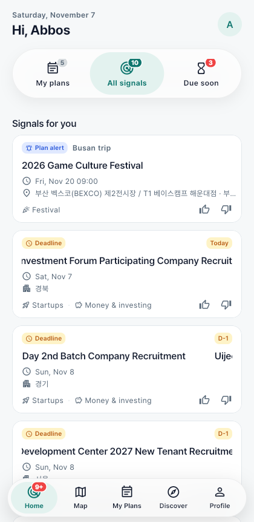
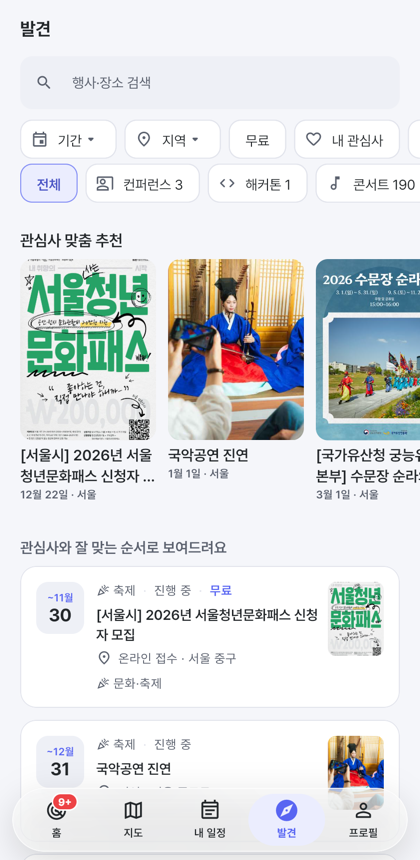
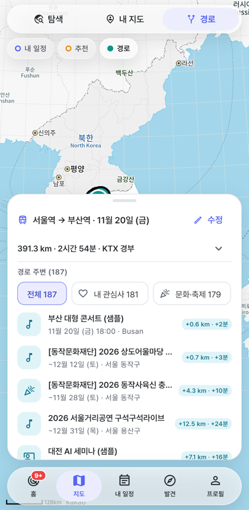
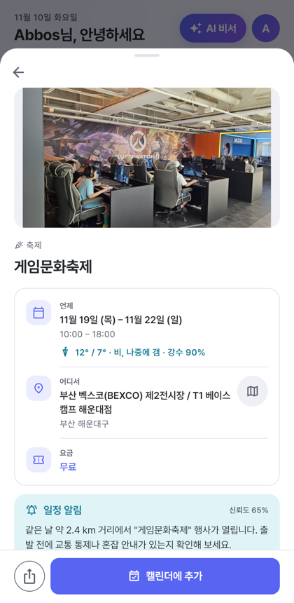
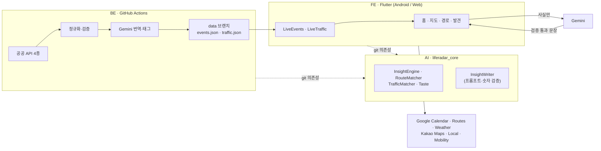

# LifeRadar — 내 일정을 챙기는 AI 동료

> **WOOWANGTHON TEAM 27** · 2026 AI 우왕톤 · 주제 *"AI는 동료가 될 수 있을까?"* — 청년의 삶
>
> 저장소: **FE (이 저장소, Flutter 앱)** · [BE (데이터 파이프라인)](https://github.com/woowangthon/WOOWANGTHON_TEAM_27_BE) · [AI (판단 엔진·AI 모듈)](https://github.com/woowangthon/WOOWANGTHON_TEAM_27_AI)

**LifeRadar는 내 캘린더 일정과 관심사를 실제 행사·공식 교통 통제·날씨와 연결해, 묻기 전에 "이건 당신에게 중요해요, 이유는 이거예요"라고 알려주는 앱입니다.** 갈지, 캘린더에 넣을지는 사용자가 결정합니다.

<p align="center">
  
  
  
  
</p>

## 1. 문제

대학생·취업 준비생·주니어 개발자의 하루는 일정과 이동으로 가득합니다. 그런데 **나에게 영향을 주는 정보는 흩어져 있고, 내가 먼저 찾아야만 보입니다.**

| 문제 | 현실의 예 |
|---|---|
| **정보가 내 일정과 연결되지 않는다** | 부산 출장 날 숙소 근처에서 대형 축제가 열려도, 일정·행사·교통 공지를 각각 따로 봐야 알 수 있다 |
| **기회를 놓친다** | 관심 분야의 세미나·창업 지원 공고는 직접 찾지 않으면 마감이 지난 뒤에야 안다 |
| **질문해야만 답을 준다** | 검색 엔진·지도·AI 챗봇 모두 "무엇을 물어야 할지" 알아야 쓸 수 있다 |
| **이동 경로는 고려되지 않는다** | "KTX로 가는 길에 잠깐 들를 만한 행사"를 보여주는 서비스가 없다 |
| **AI의 말을 믿기 어렵다** | 생성형 AI는 없는 행사나 틀린 날짜를 그럴듯하게 만들어낸다 |

## 2. 해결 — "알려주는 것은 AI, 결정은 사람"

대회 주제의 예시처럼, LifeRadar는 **먼저 찾아서 이유와 함께 알려주는 동료**이고 **최종 결정은 사용자**가 합니다.

```
 내 일정 (Google 캘린더)        실제 행사 (공공 API 3종, 매일)        이동 (KTX·자동차 경로)
 내 관심사 · 👍/👎 취향         공식 도로 통제 (TOPIS, 3시간마다)     날씨 예보
                \                          |                          /
                 └──────────  판단 엔진 (규칙, 결정론적)  ─────────────┘
                                         │  "무엇을, 왜 보여줄지"
                                         ▼
                         Gemini — "왜 나에게 중요한지" 문장만 작성
                                         │  코드 검증: 입력에 없는 숫자 → 거부
                                         ▼
          홈 카드 (일정 연결 줄 · 신뢰도 · 출처 · ✨AI 표시) · 지도 · 알림
                                         │
                       사용자가 결정: 캘린더에 추가 / 신청 / 👍👎
```

**시나리오** — 11월 20일 부산 출장이 캘린더에 있다면:
- 출장 날 숙소 2.4 km 거리 벡스코에서 **게임문화축제**(실제 TourAPI 데이터)가 열린다는 **참고 카드** — 공식 교통 영향 정보가 없으므로 "확인되지 않음"이라고 정직하게 표시
- 서울→부산 **KTX 경로 근처 대전의 AI 세미나**: "+7.1 km · +17분" — 자동차로 바꾸면 고속도로가 멀어 추천하지 않음
- AI 관심사에 맞는 **창업 지원 공고 마감 D-2** 알림 → 신청 페이지로 바로 이동, 캘린더에 추가
- 콘서트 카드에 👎 → 비슷한 콘서트는 내려가고 다른 관심사가 올라옴

## 3. 주요 기능

| 기능 | 무엇을 하나 | 왜 필요한가 |
|---|---|---|
| **홈 — 신호 카드** | 일정 × 행사 × 날씨 × 관심사 × 교통 통제로 카드 자동 생성: 체류 중 기회, 근처 대형 행사 참고, 공식 도로 통제, 비 예보, 신청 마감, 새 기회 | 묻지 않아도 "오늘 알아야 할 것"을 먼저 보여준다 |
| **일정 연결 줄** | 카드마다 "11월 20일 · Busan trip / 같은 날 · 2.4 km 거리"처럼 어떤 일정과 왜 연결됐는지 | 추천의 이유가 한눈에 보여야 믿을 수 있다 |
| **AI가 쓴 이유** | Gemini가 엔진이 고른 사실로 이유를 한국어·영어 문장으로 작성 (✨ AI 표시, 실패 시 규칙 문장) | 기계적인 "관심사와 일치" 대신 내 상황에 맞는 설명 |
| **취향 학습** | 👍/👎/숨기기가 태그·카테고리 가중치를 바꿔 홈·발견·지도·경로를 다시 정렬 | 한 번 "이건 아니야"라고 하면 실제로 줄어들어야 한다 |
| **경로 기반 발견** | 출발·도착·날짜 → KTX(대중교통)·자동차 경로와 15 km 안의 같은 날 행사, 추가 거리·시간 | 이미 정해진 이동 시간 안에서 "조금만 돌아가면 되는 기회" |
| **공식 교통 통제** | 서울시 TOPIS의 집회·행사·공사 통제가 일정 장소 1 km 이내·시작 전 2시간이면 경고 | 행사 개최만으로 혼잡을 단정하지 않고, 공식 정보가 있을 때만 경고 |
| **Google 캘린더** | 향후 90일 일정 읽기, 행사 추가, 일정 수정·삭제. Android는 Google 캘린더 앱으로 열기 | 사용자의 실제 계획이 있어야 "나와 관련된" 신호가 된다 |
| **발견** | 관심사·취향 순의 실제 행사 목록, 데이터 갱신 시각 표시 | 홈 카드 밖의 기회도 둘러볼 수 있게 |
| **알림** | 2일 이내 마감·3일 이내 일정 경고를 시스템 알림으로 (Android·웹) | 시간이 중요한 신호는 앱을 열 때까지 기다리면 늦다 |
| **ko / en · 라이트/다크** | 모든 화면 2개 언어, 행사명도 영어로 번역 | 한국에 사는 외국인 유학생도 쓸 수 있게 |

## 4. 데이터 — 어디서, 언제 오나요

| 데이터 | 출처 | 갱신 | 앱이 받는 방법 |
|---|---|---|---|
| 실제 행사 635건 (11/8) | 서울 열린데이터광장 문화행사 · 한국관광공사 TourAPI 축제 · 창업진흥원 K-Startup 공고 | 매일 06:00 KST | BE가 게시한 `events.json` (캐시 → 최신 다운로드 → 검증 후 교체, 오프라인 동작) |
| 공식 도로 통제 | 서울시 TOPIS 실시간 돌발정보 | 3시간마다 | BE가 게시한 `traffic.json` |
| 내 일정 | Google Calendar API | 연결·새로고침 시 | 사용자 OAuth 동의 후 직접 호출 |
| 경로 | Google Routes (대중교통) · Kakao Mobility (자동차) | 요청 시 | 직접 호출 |
| 날씨 | Google Weather | 일정 10일 전부터 | 직접 호출 (장소별 캐시) |
| 지도·장소 | Kakao Maps SDK · Kakao Local | 요청 시 | 직접 호출 |
| 시연 데이터 | 부산 출장·대전 세미나 등 | 날짜 자동 이동 | `샘플` 배지로 구분 |

모든 공공데이터는 **공공누리** 라이선스이며 출처를 상세 화면에 표시합니다. 관심사·직접 만든 일정·피드백은 **기기에만** 저장됩니다.

## 5. AI 활용과 신뢰성

| 단계 | 담당 | 역할 |
|---|---|---|
| 사실 | 공공 API | 날짜·장소·요금·링크는 원본 그대로 |
| 판단 | 규칙 엔진 (코드) | 어떤 일정과 어떤 행사를 연결할지, 거리·기간·점수 — 결정론적, 테스트됨 |
| 설명 | **Gemini** | 고른 사실로 "왜 중요한지" 문장 작성 (구조화 JSON) |
| 번역 | **Gemini** (BE) | 한국어 행사명 → 영어, 허용 목록 안에서 관심사 태그 |
| 검증 | 코드 | 문장 속 **모든 숫자가 입력 사실에 있어야** 통과, 언어·형식 확인, 실패 시 규칙 문장 |

**실측 평가** (실제 Gemini API, 시나리오 카드 6개): 검증 통과 6/6. 평가 중 혼잡 참고 카드에서 모델이 *"이동 경로에 영향을 줄 수 있다"* 는 확인되지 않은 주장을 덧붙이는 것을 발견해, 해당 카드와 교통 통제 카드는 **AI 대상에서 제외**했습니다. 자세한 내용은 [AI 저장소](https://github.com/woowangthon/WOOWANGTHON_TEAM_27_AI#실측-평가-실제-gemini-api).

## 6. 기존 서비스와의 차이

| | 캘린더 앱 | 지도 앱 | 행사·대외활동 플랫폼 | AI 챗봇 | **LifeRadar** |
|---|---|---|---|---|---|
| 묻기 전에 먼저 알려줌 | △ 일정 알림만 | ✕ | △ 구독 알림 | ✕ | **◎** |
| 내 일정 × 외부 행사·교통 연결 | ✕ | ✕ | ✕ | ○ 물어보면 | **◎ 자동** |
| 이동 경로 주변 기회 + 우회 비용 | ✕ | △ 주변 장소 검색 | ✕ | ✕ | **◎** |
| 신청 마감 추적 | ✕ | ✕ | ○ | ✕ | **◎** |
| 이유 + 출처 + 신뢰도 | ✕ | ✕ | ✕ | ○ (출처 불확실) | **◎** |
| AI 사실 오류 방지 장치 | — | — | — | △ | **◎ 숫자 검증** |

◎ 핵심 · ○ 지원 · △ 일부 · ✕ 없음 — *팀의 비교이며 각 서비스의 기능은 바뀔 수 있습니다.*

**핵심 차별점**: 다른 서비스는 *시간(캘린더)*, *공간(지도)*, *정보(행사·AI)* 중 하나를 잘합니다. LifeRadar는 셋을 한 번에 교차시켜 **사용자가 존재조차 몰랐던 기회와 위험**을 찾고, 근거를 숫자와 출처로 보여줍니다.

## 7. 아키텍처



## 8. 실행

```bash
cp env.example.json env.json      # 키 입력 — docs/DEVELOPER.md 2장
flutter pub get
dart run tool/gen_web_env.dart
flutter run -d chrome --web-port=8080 --dart-define-from-file=env.json
flutter build apk --release --split-per-abi --dart-define-from-file=env.json   # Android
```

- 개발자 가이드: [docs/DEVELOPER.md](docs/DEVELOPER.md) · 사용자 가이드: [docs/USER_GUIDE.md](docs/USER_GUIDE.md)
- 시연 시나리오: [docs/DEMO.md](docs/DEMO.md) · MVP 계획: [docs/PLAN.md](docs/PLAN.md) · 서버 푸시 설계: [docs/PUSH_NOTIFICATIONS.md](docs/PUSH_NOTIFICATIONS.md)

## 9. 기술 스택

| 영역 | 기술 |
|---|---|
| 앱 | Flutter 3.41 (Android · Web), Riverpod 3, go_router, gen_l10n, shared_preferences |
| 판단·AI | `liferadar_core` (AI 저장소) — 규칙 엔진, Gemini `gemini-3.5-flash-lite` (예비 `3.1-flash-lite`) |
| 데이터 | BE 저장소 — 공공 API 4종, GitHub Actions 스케줄, 정적 JSON (raw.githubusercontent.com) |
| 지도·경로 | Kakao Maps SDK, Kakao Local · Mobility, Google Routes |
| 일정·로그인·날씨 | Google Calendar API, Google Sign-In (Android·웹), Google Weather |
| 알림 | Android `flutter_local_notifications`, 웹 Notification API |
| 디자인 | 자체 디자인 시스템 (라이트/다크, 대비 ≥ 4.5:1, 동작 줄이기 지원), Pretendard 서브셋 글꼴 |
| 품질 | 테스트 — FE 38 · AI 41 · BE 19개, 3개 저장소 모두 GitHub Actions CI |

## 10. 구현 범위와 한계 (정직하게)

**직접 구현**: 앱 전체 UI·상태·캐시, 규칙 엔진, AI 프롬프트·검증, 수집기와 스케줄 게시, 디자인 시스템, 테스트.
**외부 기술**: Google(Calendar·Routes·Weather·Gemini·Sign-In), Kakao(Maps·Local·Mobility), 공공 API 4종.
**AI 코딩 도구**: 개발 과정에서 AI 코딩 도우미(Claude)를 사용했고 커밋에 공동 작성자로 표시했습니다.

**샘플·미검증 범위**
- IT 컨퍼런스·해커톤(대전 AI 세미나, 벡스코 AI 엑스포 등)은 공개 API가 없어 **샘플** — 화면에 `샘플` 배지로 표시
- 공식 교통 통제는 **서울만** (전국: ITS·경찰청 UTIC API 신청 중)
- 알림은 **앱 실행 중**에만 — 앱이 닫혀 있을 때의 서버 푸시(FCM)는 설계만
- 지도·경로·날씨·Gemini 키가 **데모를 위해 앱 안에** 있음 → 다음 단계: BE의 API 프록시
- 관심사·일정·피드백은 **기기에만** 저장 (기기 간 동기화 없음)
- 대중교통 "추가 시간"은 가장 가까운 역에서 행사장까지 왕복 기준의 추정치
- AI 문장 품질은 시나리오 카드 기준으로만 평가 (정답셋 정량 평가 없음)

## 11. 개발 기록

| 날짜 | 내용 |
|---|---|
| 11/5 | 기획, MVP 계획, Flutter 골격, 카카오 지도 |
| 11/6 | 경로 기반 발견(KTX·자동차), Google 캘린더 연동, 날씨, 온보딩, 규칙 인사이트 엔진, 디자인 시스템 |
| 11/7 | 실제 공공데이터 수집 + Gemini 번역, 첫 실행 설정·계정 삭제, liquid glass UI, Gemini 카드 문장 + 숫자 검증, 피드백 취향 학습, 시연 데이터 자동 이동, 친절한 오류 메시지 |
| 11/8 | 매일 데이터 갱신, Android 알림·Google 캘린더 앱 연결, 공식 교통 통제(TOPIS) 판별, 일정 연결 줄, FE·BE·AI 팀 저장소로 분리 이전 |

2026-11-05부터 개인 작업 저장소에서 개발했고, 2026-11-08 팀 저장소(FE·BE·AI)로 이전했습니다.

## 팀 — DALAB (Team 27)

| 이름 | 역할 |
|---|---|
| Abbos Aliboev | 기획 · 아키텍처 · 디자인 · 개발 (FE·BE·AI) |
| 전영우 (Jeon Yeongwoo) | 데이터 조사 · 교통 영향 판별 규칙 설계 · 레퍼런스 디자인 |
