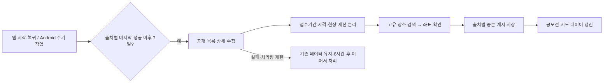

# 공모전 주간 수집과 지도 표시

2026-11-13. 목표: 앱이 약 7일마다 링커리어·요즘것들·씽굿의 공모전 정보를 수집하고, 확인된 현장 개최일·장소를 지도에 반영한다. 수동 일괄 입력은 검증 자료로만 사용한다.

## 구현된 흐름



- 공통 `PublicContestParser` / `PublicContestCollector`: 로그인 없이 공개 화면에 포함된 HTML·구조화 데이터만 해석한다. 접근 제한을 우회하지 않는다.
- FE `WeeklyContests`: 출처별 성공·시도·처리한 URL 시각을 기기에 기록한다. 7일 이내 성공 출처는 요청하지 않고 실패/일부 처리에는 최소 6시간 간격을 적용한다. 동시 호출 중복을 막는다.
- Android 앱은 별도 운영 서버 없이 직접 수집한다. `CONTEST_DIRECT_ENABLED=false`로 끌 수 있다. 웹은 CORS 제약 때문에 직접 수집을 기본 사용하지 않는다.
- 개발자가 `CONTEST_LINKAREER_URL`, `CONTEST_THINKGOOD_URL`, `CONTEST_ALLFORYOUNG_URL`에 HTTPS POST 수집 어댑터를 설정하면 해당 출처는 서버 경로를 쓴다. 현재 이 서버 어댑터는 배포하지 않았으며 세 값은 빈 값이다. Android 기본 직접 수집에는 필요 없다.
- 한 번에 출처별 상세 최대 12건을 순차 요청하고 요청 사이 750ms를 둔다. 이미 확인한 URL은 건너뛰어 다음 실행이 남은 공고를 처리한다. 마감되어 캐시에 넣지 않은 공고도 처리 시각을 기억하여 첫 12건만 무한 반복하지 않는다.
- 이미 아는 접수 중 공고와 현재 공개 목록의 후보를 함께 확인한다. 목록에서 사라진 것만으로 삭제하지 않고, 검증된 새 상세로 같은 URL의 이전 세션을 교체한다. 실패·자격 미확인은 기존 확인 정보를 유지한다.
- 후보 목록 범위는 각 사이트가 공개 초기 화면에 제공하는 항목이다. 전체 과거 공고나 사이트 전체 페이지네이션을 완전히 수집한다고 주장하지 않는다. 이미지에만 있는 자격·일정은 자동 추정하지 않는다.

## 날짜·장소 규칙

- `applicationStart`·`deadline`: 접수 시작·마감. 정확한 마감 시각이 있으면 UTC 순간과 datetime 정밀도로 보존한다.
- `start`·`end`: 좌표가 확인된 현장 세션의 개최 날짜. 날짜만 알려진 경우 상세 화면에 가짜 00:00을 보여주지 않는다.
- 대면·온라인 혼합 공고는 명시된 대면 날짜만 별도 세션으로 만든다. 중간 온라인 활동 기간을 연속 현장 행사로 만들지 않는다.
- 현장 날짜 또는 장소를 확정할 수 없으면 `placeless=true`이며 지도에 표시하지 않는다. 주최기관 주소·포털 운영회사 주소·지역 중심점을 행사장으로 사용하지 않는다.
- Kakao Local에서 고유한 일치 장소·주소만 좌표로 채택한다. 여러 동명 장소가 있으면 검토 대상으로 남긴다. 좌표는 유효한 국내 범위를 검사한다.
- 자격은 본문의 대상·자격 문구를 추출한 요약이며 세부 조건의 원문 확인이 필요하다. 참가 가능 여부를 자동 확정하지 않는다.
- 수집한 공고는 192시간(7일+재시도 1일) 검증 유효기간을 사용한다. 기존 수동 검증 공고는 종전의 48시간을 유지한다. 실패한 재조회는 항목 검증 시각을 새로 만들지 않는다.

## Android 백그라운드 실행

`ContestCollectionJob`은 Android 기본 JobScheduler에 네트워크 연결 조건과 재부팅 후 유지 옵션으로 등록된다. 작업은 6시간 주기로 **수집 기한을 검사**하고, 실제 사이트 요청은 출처별 7일 성공 주기를 따른다. 앱 실행·복귀에서도 같은 검사를 수행하고 실행 중에는 5분마다 로컬 기한·캐시를 확인한다.

- 별도 Flutter 엔진에서 `@pragma('vm:entry-point')`로 보존한 콜백을 실행한다. 화면·로그인·지도 초기화 없이 수집 캐시만 갱신한다.
- UI 엔진과 백그라운드 엔진이 동시에 저장하지 않도록 네이티브 프로세스 잠금을 사용한다. 앱 복귀 시 SharedPreferences를 다시 읽어 백그라운드 결과를 반영한다.
- OS 중단 시 엔진과 잠금을 정리하고 재시도를 요청한다. 작업당 8분 제한을 둔다.
- 정확히 7일째 특정 시각을 보장하는 알람은 아니다. 네트워크·절전·OS 작업 할당량에 따라 지연될 수 있다. 사용자가 Android 설정에서 앱을 강제 중지한 경우에는 앱을 다시 실행해야 한다.
- 자동 동작의 실제 기기 검증은 단위 테스트·APK 빌드와 구분한다. SM-S948N 실기기에서 앱 프로세스 종료 → OS 작업의 새 프로세스 시작 → 실제 사이트 수집·저장 → 지도 표시까지 검증했다. OS 작업은 시험 명령으로 기한을 앞당겨 실행했으며 7일 경과를 실제로 기다린 결과와 구분한다.

## 지도

공모전은 일반 추천 최대 60개와 별도인 보라색 **공모전 레이어**에 표시한다. 현재 접수 중·예정이며 실제 현장 날짜가 앞으로 90일 이내인 공고를 사용하고, 마감·취소·장소 미확인 항목은 제외한다. 동일 좌표의 여러 세션은 마커 하나로 묶어 날짜별 선택 목록을 연다. 새 수집 데이터가 들어오면 마커를 다시 그린다.

상세에는 접수기간과 현장 날짜를 각각 표시한다. 캘린더의 접수 마감에는 행사장 위치를 붙이지 않는다. 이 버튼은 현장 참가 확정이나 현장 일정 자동 등록을 의미하지 않는다.

## 실제 데이터 검증

`api-research/contest-portals-live-20261113.json`은 Dart 제품 파서와 실제 Kakao Local 호출 결과를 요약한다. 앱 데이터를 일괄 갱신하는 파일이 아니다.

| 출처 | 공개 목록 후보 | 실제 상세 추출 | 지도 대상 |
| --- | ---: | --- | ---: |
| 링커리어 | 20 | SVC Seoul 주거생활 AI 해커톤의 접수·자격·대면 세션 | 2개 세션 |
| 요즘것들 | 20 | 전북 AI 뮤직쇼츠 공모전의 접수·자격 | 0: 현장 미확인 |
| 씽굿 | 18 | KEIT 혁신 아이디어 공모전의 접수·자격·18시 마감 | 0: 현장 미확인 |

SVC 공고는 접수 11/10~11/29, 대면 12/7·12/11, 온라인 12/8~10을 분리했다. 장소명 검색 결과 위도 37.5548258073813, 경도 126.921526251032와 주소 서울 마포구 양화로 136을 확인했다. 이전 수동 검증의 주소 중심점과는 같은 건물 안에서 약간 차이가 난다. 비밀키는 검증 JSON에 저장하지 않는다.

처음 요청에서 타임아웃이 한 번 있었으며 후속 실조회에서 세 출처 모두 성공했다. 요즘것들은 UTF-8 바이트 길이로 구분된 React Flight 텍스트 레코드 뒤에 JSON 레코드가 바로 이어지는 구조를 실제 응답으로 확인하고 파서를 수정했다. JavaScript를 실행하는 방식이 아니다.

## 검증과 재현

- FE 전체 테스트 108개 통과: 주간 경계, 재시도, 부분 실패, 닫힌 공고를 지나 다음 배치 진행, 직접 공개 페이지→캐시→지도, 독립 공모전 레이어 및 기존 앱 회귀.
- AI 전체 101개 통과(공모전·공개 출처 관련 14개 포함): 세 출처 형식, Flight 바이트 경계, 대면/온라인 분리, 정확한 마감, URL 위장·변경된 HTML·403·모호한 지오코딩 방어.
- 변경 파일 정적 분석 통과. APK 2016의 armeabi-v7a·arm64-v8a·x86_64 빌드와 실기기 설치·등록·실행을 확인했다. 최초 2015 실기기 검사에서 ACCESS_NETWORK_STATE 권한 누락을 발견해 2016에서 수정했으며, OS의 실제 작업 등록 성공과 네트워크 제한 조건을 확인했다.
- 운영 피드 게시·원격 push는 하지 않았다. 로컬 FE는 기존 `pubspec_overrides.yaml`로 옆 AI 저장소를 사용한다. 분리된 원격 저장소에서 빌드하려면 AI 변경을 먼저 반영하고 Git 의존성을 실제 커밋에 고정해야 한다.

실사이트 재조회(AI 폴더):

```powershell
dart run tool/eval_public_contests.dart ../WOOWANGTHON_TEAM_27_FE/env.json
```

이 명령은 공개 목록·선정한 상세 3건과 장소 검색을 검증하고 `out/public-contest-live.json`에 결과를 기록한다. 전체 수집률이나 앱 종료 중 OS 실행 성공을 증명하는 명령은 아니다.


## 실기기 결과

`api-research/contest-device-20261113.json`에 실제 검증을 기록했다.

- 앱 프로세스가 없는 상태에서 OS 시험 명령으로 새 프로세스가 시작됨을 확인. 먼저 최근 수집 시각을 지키며 `updated=false`로 끝나는 동작도 확인했다.
- 별도 동일 서명의 instrumentation으로 새 공모전 체크포인트와 선정한 SVC 세션의 검증 시각만 시험 만료시켰다. 계정·일정·관심사 값을 초기화하지 않았다.
- 화면 없는 실제 수집이 `success=true, updated=true, count=56`으로 완료됐다. 기기 캐시에서 링커리어 21·씽굿 11·요즘것들 7건과 기존 다른 출처 17건을 확인했다. 이는 중복 제거한 공모전 56개가 아니라 공고·세션 레코드 56건이다.
- SVC 기존 수동 세션 2개가 실제 공고에서 다시 읽은 날짜별 ID 2개로 교체됐고, 좌표 재검색과 지도 표시를 확인했다. 화면에서 12/7·12/11을 선택할 수 있었다.
- 링커리어·씽굿의 해당 공개 목록 배치는 성공 체크포인트를 기록했다. 요즘것들은 처리량 제한 등에 따라 partial로 남았으며 다음 재시도에서 이어간다.
- 시험용 만료 시각이 남지 않았음을 확인하고 임시 시험 패키지와 UI 덤프를 제거했다. 제품 앱의 주기 작업은 `waiting`으로 유지했다.

## 출처와 운영 고려

공식 제휴 API로 가장하지 않고 출처 이름·원문 링크를 보존한다. 포스터·전체 본문을 앱 피드로 복제하지 않는다. 출처별 자동 수집·재제공 조건은 운영 배포 전에 확인해야 하며 이번 실조회가 재이용 허가를 의미하지 않는다. 401/403/429에는 출처 요청을 중단한다.

- [링커리어 공모전](https://linkareer.com/list/contest), [실제 SVC 공고](https://linkareer.com/activity/363236)
- [요즘것들 공모전](https://www.allforyoung.com/posts/contest), [실제 전북 공고](https://www.allforyoung.com/posts/89842)
- [씽굿 공모전](https://www.thinkcontest.com/thinkgood/user/contest/index.do), [실제 KEIT 공고](https://www.thinkcontest.com/thinkgood/user/contest/view.do?contest_pk=112681)
- [Android JobInfo.Builder](https://developer.android.com/reference/android/app/job/JobInfo.Builder)
- [Flutter DartCallback](https://api.flutter.dev/javadoc/io/flutter/embedding/engine/dart/DartExecutor.DartCallback.html)
- [Flutter AppLifecycleListener](https://api.flutter.dev/flutter/widgets/AppLifecycleListener-class.html)
- [Kakao Local](https://developers.kakao.com/docs/ko/local/dev-guide)
