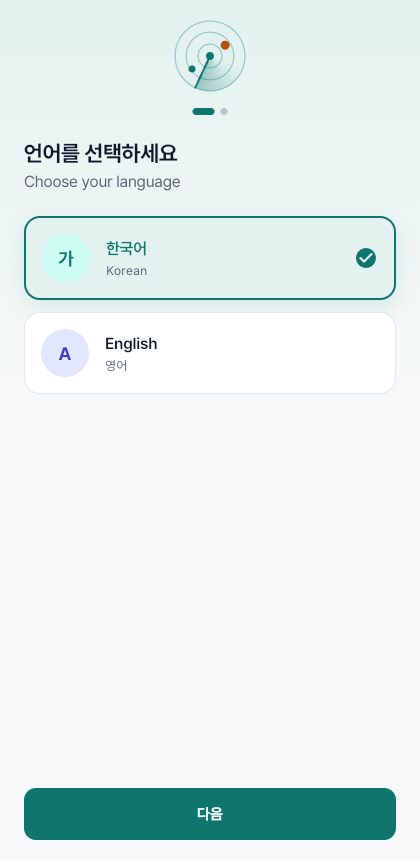
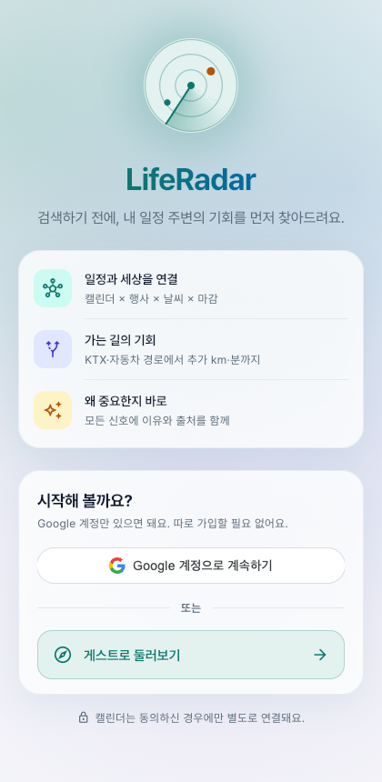
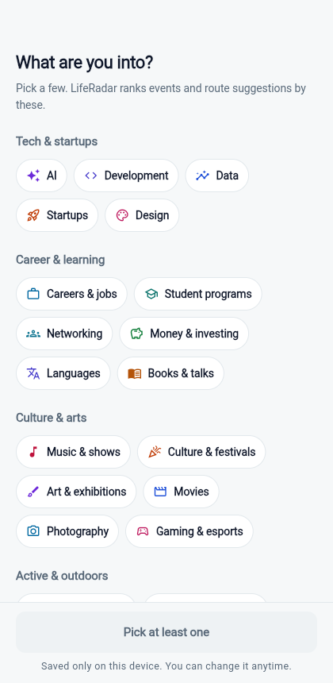
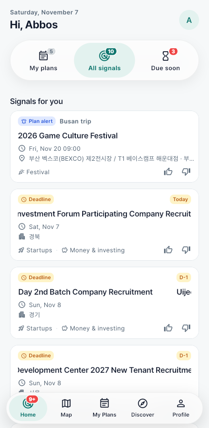
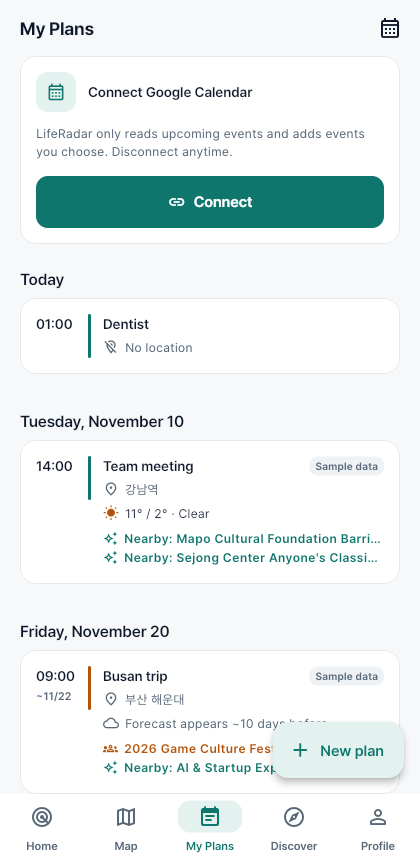
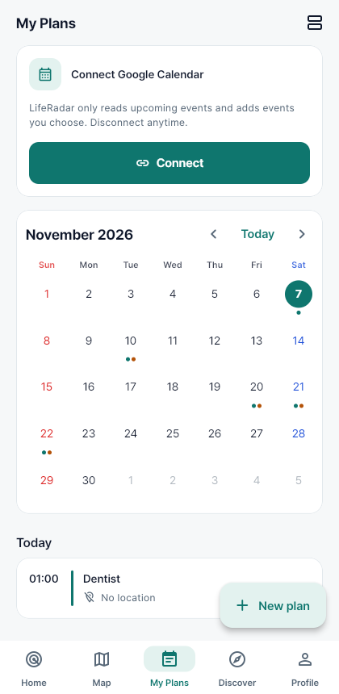
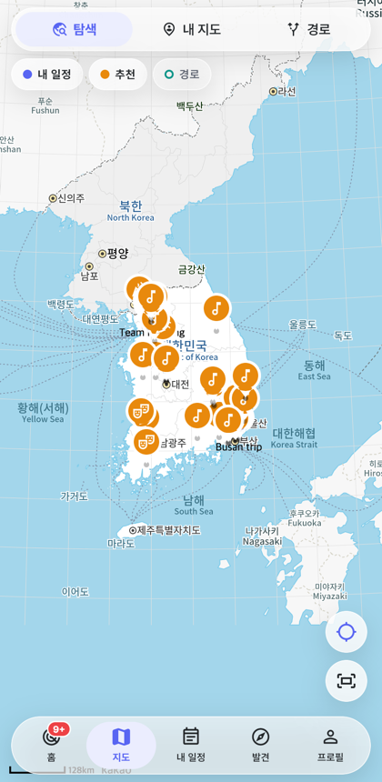
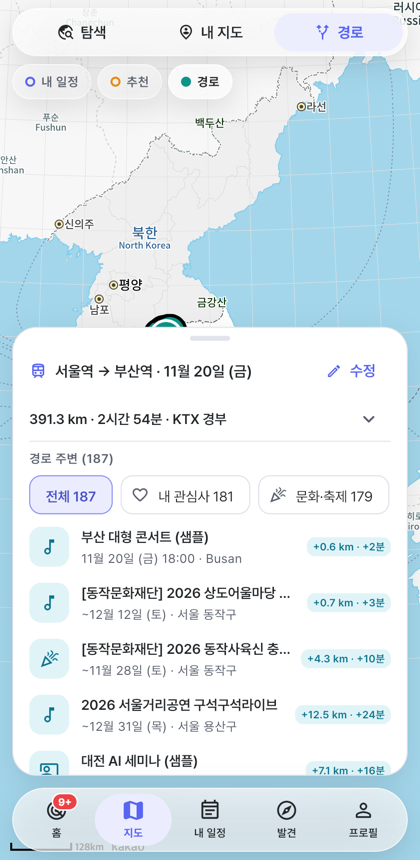
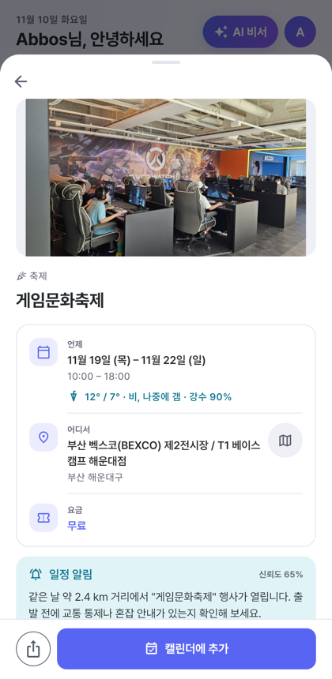
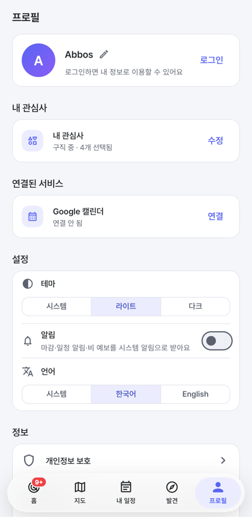

# LifeRadar 사용자 가이드

> **내 일정 근처에서 무슨 일이 일어나는지, LifeRadar가 먼저 찾아드려요.**

LifeRadar는 여러분의 일정과 관심사를 바탕으로 **가는 길과 방문하는 곳 주변의 행사·기회**를 찾아주고,
그것이 **왜 나에게 중요한지** 알려주는 앱입니다.

---

## 이런 분께 좋아요

- 다른 도시로 이동할 일이 자주 있는 분
- AI, 스타트업, 개발 행사나 해커톤을 놓치고 싶지 않은 학생·취업 준비생
- 일정, 날씨, 행사 정보를 여기저기서 따로 확인하는 게 번거로운 분

---

## 처음 시작하기 — 언어와 테마

앱을 처음 설치하면 두 가지만 먼저 골라요.

1. **언어** — 한국어 또는 English. 누르는 즉시 화면 언어가 바뀌어요.
2. **테마** — 시스템 / 라이트 / 다크. 미리보기 그림으로 확인하고 고르면 바로 적용돼요.

**시작하기**를 누르면 로그인 화면으로 넘어가요. 두 설정은 이 기기에 저장되고, **프로필 → 설정**에서 언제든 바꿀 수 있어요.

 

---

## 로그인

- **Google로 계속하기** — Google 계정으로 바로 시작해요. 따로 회원가입할 필요가 없어요. (이름·이메일·프로필 사진만 프로필에 보여요.)
- **게스트로 둘러보기** — 로그인 없이 모든 기능을 둘러볼 수 있어요. 나중에 프로필에서 로그인할 수 있어요.

> 캘린더는 로그인과 별도로, **내 일정** 탭에서 동의한 경우에만 연결돼요.

로그인 후에는 두 단계가 이어져요.

1. **이름** — "어떻게 불러드릴까요?" 홈 화면 인사(예: *Abbos님, 안녕하세요*)에 쓰여요. Google 이름이 미리 채워지지만 원하는 이름으로 바꿀 수 있어요. 프로필의 ✏️로 나중에 수정해요.
2. **관심사** — 아래 "관심사 고르기"를 참고하세요.

이름과 관심사는 **계정별로 저장**돼요. 다시 로그인하면 바로 홈으로 가요.

 

---

## 관심사 고르기

앱을 처음 열면 **"어떤 분야에 관심 있으세요?"** 화면이 나와요.

1. **기술·창업, 커리어·배움, 문화·예술, 운동·야외, 일상·라이프** 5개 그룹, 26가지 관심사(맛집, 러닝, 반려동물, 전시, 게임, 가족 나들이 등)에서 **관심 있는 것을 몇 개** 고르세요. 관심사마다 색이 달라서 한눈에 구분돼요.
2. **계속**을 누르면 홈으로 이동해요.

고른 관심사는 **발견 탭의 순서**, **경로 추천 순위**, 행사의 **추천 이유**에 바로 반영돼요.
이 기기에 **계정별로** 저장돼요. 로그아웃했다가 같은 Google 계정으로 다시 들어오면 다시 고를 필요가 없어요. **프로필 → 내 관심사 → 수정**으로 언제든 바꿀 수 있어요.

 

---

## 화면 한눈에 보기

앱 아래쪽에 떠 있는 5개의 탭이 있어요. **홈** 아이콘의 빨간 숫자는 아직 열어 보지 않은 신호 수예요.

| 탭 | 하는 일 |
|---|---|
| 🎯 **홈** | 내 일정과 관련된 중요한 소식을 카드로 보여줘요 |
| 🗺️ **지도** | 내 일정, 추천 행사, 이동 경로를 지도에서 봐요 |
| 📅 **내 일정** | 일정을 직접 추가·수정하거나 Google 캘린더에서 가져와요 |
| 🧭 **발견** | 실제 공연·전시·축제·창업 공고를 관심사 순으로 둘러봐요 |
| 👤 **프로필** | 이름, 관심사, 캘린더 연결, 테마·언어 설정, 로그아웃 |

**프로필 → 설정**에서 **테마**(시스템/라이트/다크)와 **언어**(시스템/한국어/English)를 바꿀 수 있어요.

---

## 1. 홈 — 나를 위한 신호

홈에는 LifeRadar가 찾아낸 **신호 카드**가 있어요. 한눈에 읽히도록 꼭 필요한 것만 보여줘요.

- **무엇** — 행사·공고 이름 (길면 옆으로 천천히 흘러가요)
- **언제 · 어디서** — 날짜/시간, 장소 (창업 공고는 마감일과 지역)
- **누구에게** — 내 관심사 중 맞는 것 (예: 스타트업, 음악·공연)
- 오른쪽 위 **D-3 / 오늘** — 마감이 가까우면 표시돼요

카드를 누르면 **포스터, 이 신호가 뜬 이유, 신뢰도, 출처 링크, 신청·캘린더 추가** 같은 자세한 내용이 열려요. 상세 화면은 거의 전체 높이로 열리고, 위쪽을 **끌어 올리면 더 크게(95%)**, 끌어 내리거나 왼쪽 위 **←**를 누르면 닫혀요.
한 번 열어 본 카드는 **살짝 흐리게** 보여서 이미 본 것을 알 수 있어요.

맨 위 숫자 세 개는 **필터**예요. 기본은 **전체 신호**이고, **내 일정**은 일정과 관련된 신호만, **마감 임박**은 신청 마감이 가까운 것만 보여줘요.
화면을 내려도 필터는 위에 **작은 반투명 막대**로 붙어 있어요. 목록을 **좌우로 밀어서** 필터를 바꿀 수도 있어요.

- 👍 — 비슷한 신호를 더 보여줘요
- 👎 — **"관심 없는 신호인가요?"** 확인 후 비슷한 신호를 줄이고 카드를 아래로 내려요

알림은 화면 위에서 내려오는 **토스트**로 보여줘요 (성공은 초록, 오류는 빨강).

> ℹ️ 카드가 하나도 없으면 **캘린더 연결** 또는 **관심사 추가** 버튼이 보여요.

 

---

## 2. 내 일정 — Google 캘린더 연결하기

1. **📅 내 일정** 탭에서 **Google 캘린더 연결**을 누르세요.
2. Google 로그인 창에서 계정을 선택하세요.
3. **"Google에서 확인하지 않은 앱"** 이라는 화면이 나오면 → **고급** → **LifeRadar(으)로 이동**을 누르세요.
   (현재 테스트 중인 앱이라 나오는 정상적인 안내예요.)
4. 권한 화면에서 **캘린더 항목에 체크**하고 **계속**을 누르세요.
5. 앞으로 90일 동안의 일정이 목록에 나타나요. **장소가 적힌 일정**은 지도에 파란 핀으로도 표시돼요.

### 한눈에 보기 — 목록 / 월간 달력

오른쪽 위 📅 버튼으로 **월간 달력**으로 바꿀 수 있어요 (선택은 기억돼요).
- 일정이 있는 날엔 **점**, 그 일정에 소식이 있으면 **주황 점**이 찍혀요. 일요일은 빨강, 토요일은 파랑.
- 날짜를 누르면 그날 일정이 아래에 나와요. **＋ 새 일정**은 선택한 날짜로 시작해요.
- 캘린더가 연결되어 있으면 위쪽 얇은 줄을 눌러도 월간 달력이 열리고, ↗ 로 Google 캘린더를 바로 열 수 있어요.

### 일정 카드와 상세

일정 카드 아래에는 그 일정에 영향을 줄 **소식이 한 줄**로 보여요 (최대 2개).
예: ☔ *비 예보 — 우산을 챙기세요*, 👥 *근처 게임문화축제 — 혼잡 예상*, ✨ *근처: AI 엑스포*
(날씨 API와 공공 행사 데이터를 규칙으로 계산한 결과예요.)

카드를 누르면 **일정 상세**가 열려요: **언제 · 어디서**(지도 버튼), 날씨, **이 일정 주변 소식**(누르면 행사 상세), 메모. 아래 **수정** 버튼으로 편집해요.

 

### 일정 직접 추가·수정하기

- 오른쪽 아래 **＋ 새 일정**을 누르면 제목, 날짜·시간(종일 가능), 장소, 메모를 적을 수 있어요.
- 장소는 검색해서 고르면 지도에 표시되고, 그날 날씨와 주변 신호도 함께 보여요.
- 일정 상세의 **수정**에서 내용을 바꾸거나 🗑 **삭제**할 수 있어요.
- 캘린더가 연결되어 있으면 **"Google 캘린더에도 저장"**을 켤 수 있고, 캘린더에서 가져온 일정을 고치면 Google 캘린더에도 반영돼요.
- 샘플 일정은 저장하면 내 일정이 돼요.

- **동기화** — 캘린더를 바꿨다면 눌러서 새로 불러와요
- **연결 해제** — 언제든 연결을 끊을 수 있어요

> 💡 일정에 **장소**(예: "부산역", "강남역", "BEXCO")를 적어 두면 LifeRadar가 지도에 표시하고 주변 정보를 찾을 수 있어요.

> ☀️ 장소가 있는 일정에는 그날 **날씨 예보**(최고/최저 기온, 강수 확률)가 함께 보여요. 비 올 확률이 높으면 파란색으로 강조돼요.
> 예보는 **약 10일 전부터** 나와요. 그보다 먼 일정은 "예보는 약 10일 전부터 제공"이라고 표시돼요.

 

---

## 3. 지도 — 내 주변과 가는 길 살펴보기

지도 위쪽에서 **보기 모드**를 고를 수 있어요.

| 모드 | 보여주는 것 |
|---|---|
| **탐색** | 내 일정 + 추천 행사 전체 |
| **내 지도** | 내 일정 장소만 |
| **경로** | 출발지→목적지 경로와 그 주변 기회 |

그 아래 칩으로 **레이어**를 켜고 끌 수 있어요.
🔵 내 일정 · 🟠 추천 · 🟢 경로

핀을 누르면 행사 정보가 아래에서 올라와요. **내 일정 핀**을 누르면 일정 상세가 열리고, 바로 **수정**할 수 있어요.

**내 위치** — 지도를 열면 위치 권한을 한 번 물어봐요. 허용하면 **파란 점**으로 내 위치가 보이고, 오른쪽 아래 ⌖ 버튼을 누르면 내 위치로 이동해요. 위치는 지도 표시에만 쓰이고 어디에도 보내지 않아요. (거부했다면 브라우저·기기 설정에서 다시 허용할 수 있어요.)

 

---

## 4. 경로 — 가는 길에 들를 만한 기회 찾기

다른 도시로 가는 날, 가는 길 근처에서 열리는 행사를 찾아줘요.

1. **지도** 탭 → 위쪽에서 **경로** 선택
2. 이동 수단 선택: **🚆 대중교통**(KTX 등) 또는 **🚗 자동차**
3. **출발**, **도착**을 눌러 장소를 검색해요 (예: 서울역, 부산역)
4. 📅 날짜를 고르고 **경로 주변 기회 찾기**를 눌러요
5. 지도에 경로가 그려지고, 아래에 **가는 길에 있는 행사** 목록이 나와요

목록에는 이렇게 표시돼요:
- **+7.1 km · +17분** — 그 행사에 들르면 추가로 드는 거리와 시간
- 같은 날 열리는 행사만, 경로에서 15 km 이내만 보여줘요

- 위쪽 칩으로 **전체 · 내 관심사 · 카테고리**별로 걸러 볼 수 있어요. 지도 핀도 같이 걸러져요.

패널 위의 **손잡이를 아래로 끌거나**, **지도를 누르면** 패널이 내려가 지도를 넓게 볼 수 있어요. 내려간 패널을 누르거나 위로 끌면 다시 펼쳐져요. (처음 한 번은 움직이는 안내가 나와요.)

> 🚆 vs 🚗 — 같은 서울→부산이라도 KTX는 대전을 지나고, 고속도로는 대전을 지나지 않아요.
> 그래서 **이동 수단에 따라 추천이 달라져요.**

 

---

## 5. 행사 상세 — 신청하고 캘린더에 추가하기

행사를 누르면 자세한 정보가 나와요.

- 날짜와 시간, 장소
- **날씨** — 행사 당일 그 장소의 예보 (10일 이내)
- **가는 길에** — 경로에서 들를 때 추가 거리와 시간 (경로 모드에서 열었을 때)
- **추천 이유** — 내 관심사와 어떻게 맞는지
- **참가 신청** — 공식 신청 페이지로 이동 (링크가 있는 행사만)
- **캘린더에 추가** — 버튼 하나로 내 Google 캘린더에 일정 등록

캘린더에 추가한 행사는 **내 일정**에도 바로 나타나요.

 

---

## 6. 발견 — 관심 있는 행사 둘러보기

서울의 **실제 공연·전시·축제·교육 행사**(서울시 공공데이터)가 관심사와 잘 맞는 순서로 나와요. `무료` 표시가 있는 행사는 무료예요.
목록이 길면 맨 아래 **더 보기**를 누르세요. 행사를 누르면 포스터, 출연진, 요금과 함께 **출처**가 보이고, **신청** 버튼은 예매·주최 페이지로 연결돼요.
전국 **축제**(한국관광공사)와 접수 중인 **창업 지원 공고**(K-Startup)도 함께 나와요. 창업 공고는 장소 대신 **접수 기간·주관 기관·지역**이 보이고, **신청하기**로 바로 지원할 수 있어요. **캘린더에 추가**하면 마감일 아침에 알림 일정이 생겨요.
`샘플 데이터` 배지가 붙은 행사는 데모용 예시예요.

**🧭 발견** 탭에서는 내 관심사(AI, 스타트업, 개발 등)와 **잘 맞는 순서**로 행사를 보여줘요.
- 🔍 **검색** — 행사 이름·장소로 찾아요
- **기간**(오늘 · 이번 주말 · 7일 안 · 한 달 안), **지역**(서울 · 부산 · 전국 공고 …), **무료**, **내 관심사**로 좁히고, **추천순 / 날짜순**으로 정렬해요
- 두 번째 줄 칩으로 **콘서트 · 연극·뮤지컬 · 전시 · 축제 · 창업 지원** 등 종류별로 볼 수 있어요 (옆 숫자 = 지금 조건에 맞는 개수)
- 필터가 없을 때는 맨 위에 **관심사 맞춤 추천** 포스터가 가로로 나와요
- 조건을 지우려면 **초기화**

---

## 7. 프로필 — 설정과 계정

- **내 관심사** — 선택한 개수만 보여요. **수정**을 누르면 전체 목록이 열려요 (관심사 변경은 프로필에서만)
- **연결된 서비스** — Google 캘린더 연결/해제
- **알림** — 켜면 알림 권한을 물어봐요 (Android는 시스템 창, 웹은 브라우저). 이미 거절했다면 설정 화면이 열려요. 허용하면 마감 임박(2일 이내)·일정 알림·비 예보가 메신저처럼 화면 구석에 떠요. **테스트 알림 보내기**로 확인할 수 있어요. (앱이 실행 중일 때 동작해요.)
- **설정** — 테마(시스템·라이트·다크), 언어(시스템·한국어·English)
- **정보** — 개인정보 보호 안내, 버전, **계정 및 데이터**
  - **계정 삭제**: 일부러 안쪽에 두었어요. 누르면 한 번 더 확인하고, 이름·관심사·내 일정·설정이 모두 지워지고 Google 권한도 해제돼요. 앱은 처음(언어 선택)부터 다시 시작해요.
- **로그아웃** — 게스트라면 "처음 화면으로"

홈을 아래로 당기면 캘린더와 날씨를 새로 불러와요.

 

---

## 개인정보는 이렇게 다뤄요

- 여러분이 **직접 연결 버튼을 눌러야만** 캘린더를 볼 수 있어요.
- LifeRadar는 **앞으로의 일정을 읽고**, **여러분이 고른 행사만 추가**해요. 캘린더 일정은 여러분이 앱에서 직접 수정·삭제할 때만 바뀌어요.
- 이름·관심사·직접 만든 일정·본 카드 기록은 **이 기기에만** 저장돼요 (서버로 보내지 않아요).
- **위치**는 지도에 내 위치를 표시할 때만 쓰고, 저장하거나 보내지 않아요.
- 로그인 정보는 이 기기에만 잠시 보관되고 서버에 저장하지 않아요.
- **연결 해제**를 누르면 바로 끊겨요.

---

## 자주 묻는 질문

**Q. 행사 정보는 어디서 오나요?**
A. 공공 데이터예요. 서울 공연·전시·축제는 **서울 열린데이터광장**, 전국 축제는 **한국관광공사**, 창업 지원 공고는 **창업진흥원 K-Startup**에서 가져와요. 행사를 누르면 아래쪽에 출처와 원문 링크가 있어요.

**Q. "샘플 데이터"라고 적힌 건 뭔가요?**
A. IT·AI 컨퍼런스와 해커톤은 공개 데이터가 없어서 데모용 예시로 넣어 둔 거예요. 장소(BEXCO, 대전컨벤션센터 등)는 실제지만 행사 내용은 예시예요.

**Q. 영어로 바꾸면 행사 이름이 영어로 나와요. 정확한가요?**
A. 원래 한국어인 행사명과 설명을 Gemini(AI)가 영어로 옮긴 거예요. 날짜·장소·요금은 원본 그대로이고, 번역된 행사에는 "Translated from Korean with Gemini" 표시가 있어요. 정확한 내용은 한국어 화면이나 원문 링크를 확인해 주세요.

**Q. 다른 기기에서 로그인하면 관심사와 일정이 그대로인가요?**
A. 아직은 아니에요. 이름·관심사·직접 만든 일정은 **이 기기에, 계정별로** 저장돼요. 같은 기기에서 다시 로그인하면 그대로 돌아와요.

**Q. 새로고침했더니 캘린더 연결이 풀렸어요.**
A. 보안을 위해 로그인 정보를 오래 보관하지 않아요. **Google 캘린더 연결**을 다시 눌러 주세요. (1시간이 지나도 다시 연결이 필요해요.)

**Q. 내 일정이 지도에 안 보여요.**
A. 일정에 **장소**가 적혀 있는지 확인해 주세요. 장소를 찾지 못한 일정은 목록에만 "장소 없음"으로 나와요.

**Q. 경로 결과에 행사가 하나도 없어요.**
A. 그날 경로 15 km 안에 맞는 행사가 없다는 뜻이에요. 날짜나 이동 수단을 바꿔 보세요.
(데모: **서울역 → 부산역, 11월 20일, 대중교통**)

**Q. "카카오 지도 SDK를 불러오지 못했습니다"가 떠요.**
A. 앱 주소가 지도 서비스에 등록되지 않은 경우예요. 개발팀에 알려 주세요.

**Q. 캘린더 연결 시 "액세스 차단됨"이 나와요.**
A. 현재 테스트 기간이라 등록된 계정만 사용할 수 있어요. 개발팀에 Gmail 주소를 알려 주세요.
